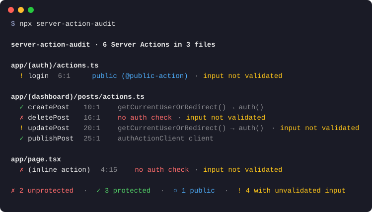

# server-action-audit

**Trouvez les Server Actions Next.js que n'importe qui peut appeler.**

Chaque fonction `"use server"` est un point d'accès HTTP public. N'importe qui peut l'appeler avec une requête POST, hors de votre interface, avec les arguments de son choix. La [documentation Next.js](https://nextjs.org/docs/app/guides/data-security) est claire : vérifier la connexion au niveau de la page ne protège pas les Server Actions qu'elle contient. Chaque action doit vérifier la session elle-même.

Cette vérification s'oublie facilement, et rien ne vous le rappelle. `server-action-audit` liste toutes les Server Actions de votre application et signale celles qui ne vérifient pas qui les appelle : dans le terminal, en CI, et dans votre éditeur grâce à ESLint.

```sh
npx server-action-audit
```



Aucune configuration nécessaire. L'outil lit votre code, il ne l'exécute jamais. Testé sur cinq grosses applications Next.js open source : 456 Server Actions, environ une seconde par application.

## Ce qu'il reconnaît

- **Les actions** : les exports des fichiers `"use server"`, et les actions déclarées dans un composant (`<form action={async () => { "use server" … }}>`).
- **Les bibliothèques d'authentification** : Auth.js / NextAuth, Clerk, Supabase, Better Auth, Lucia, Kinde, iron-session, Firebase Admin, WorkOS AuthKit.
- **Vos propres fonctions** (`getCurrentUser()`, `requireUser()`…) : il les suit d'un fichier à l'autre, à travers les alias `@/` du tsconfig, les ré-exports et `cache()` de React.
- **Les clients d'actions** : next-safe-action et zsa. L'outil lit leur middleware, y compris celui d'un client dérivé d'un autre client.
- **Seuls les contrôles du chemin principal comptent** : une vérification placée dans une branche `if` ou dans une fonction de rappel ne protège pas l'action.
- **La validation des entrées** : il prévient quand une action utilise ses arguments sans les valider (Zod, Valibot, Yup, ou un schéma next-safe-action / zsa).

## Actions publiques

Login, inscription, newsletter : certaines actions sont publiques exprès. Indiquez-le avec un commentaire juste avant l'action, ou en haut de son corps :

```ts
// Tout le monde peut s'abonner. @public-action
export async function subscribe(email: string) {}
```

## Configuration, ESLint et CI

Tout est décrit dans le [README en anglais](README.md#configuration) :
- le fichier `server-action-audit.config.json` ;
- le plugin ESLint (`server-action-audit/eslint`) ;
- les options `--fail-on`, `--json` et `--quiet` ;
- l'Action GitHub, qui annote les pull requests et peut aussi y poster le rapport en commentaire (`comment: true`).

## Limites

C'est une analyse statique, fondée sur les noms. Un rapport sans erreur veut dire « rien d'évident ne manque », pas « l'application est sûre ».

- **Elle ne vérifie pas ce que vous faites de la session.**
- **Elle ne vérifie pas l'appartenance** : être connecté ne veut pas dire avoir le droit de supprimer *ce* contenu.
- **Elle ne compte pas le middleware**, car la documentation de Next.js recommande de vérifier dans chaque action.

Un faux positif, ou une action protégée qui n'est pas reconnue ? [Ouvrez une issue](https://github.com/i6moons/server-action-audit/issues).

## Licence

[MIT](LICENSE) © Del Prudence ([@i6moons](https://github.com/i6moons))
